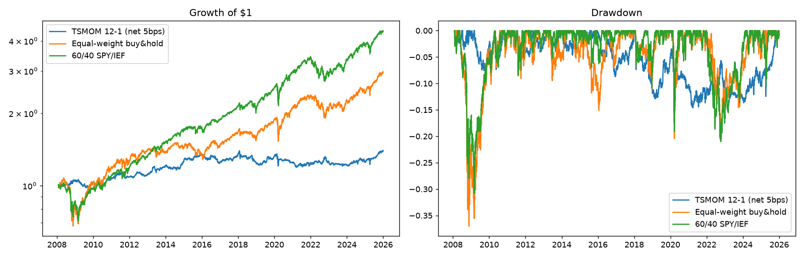

# Trend-Following Backtest (Time-Series Momentum)

A leak-free backtest of volatility-targeted time-series momentum on 8 liquid ETFs (equities, bonds, gold, commodities, real estate), with transaction costs, walk-forward parameter selection, and a bootstrap test of whether the result beats a passive benchmark. **The honest finding: it did not beat buy-and-hold on risk-adjusted return, but it cut drawdowns sharply.**

## Setup
- **Data:** daily adjusted closes from Yahoo Finance, 2007-01-03 to 2025-12-31 (4,780 days): SPY, EFA, EEM, TLT, IEF, GLD, DBC, VNQ.
- **Signal:** sign of the trailing 12-month return skipping the most recent month (12-1). Position per asset is scaled to a 10% volatility target using 60-day realised vol, divided equally across assets, gross leverage capped at 2x.
- **Execution:** monthly rebalance; weights are lagged one day so a signal using data through day t-1 trades on day t. Costs: 5 bps per unit of turnover.
- **Benchmarks:** equal-weight buy-and-hold of the same 8 ETFs, and 60/40 SPY/IEF.

## Results (`python run_experiments.py`)
| Strategy | Ann. return | Ann. vol | Sharpe | Max drawdown |
|---|---|---|---|---|
| TSMOM 12-1 (net of 5 bps) | 1.9% | 5.7% | 0.35 | -14.6% |
| Equal-weight buy-and-hold | 6.2% | 12.7% | 0.54 | -37.0% |
| 60/40 SPY/IEF | 8.6% | 11.4% | 0.78 | -30.8% |

- **Risk-adjusted performance was worse than passive.** The block-bootstrap 95% CI for the Sharpe difference vs equal-weight is [-0.75, +0.38], so the data cannot distinguish the two; the point estimate favours buy-and-hold.
- **Drawdown protection was real:** max drawdown -14.6% vs -37.0% (equal-weight), at about 45% of the volatility. It had a lower return mainly because the 10% per-asset vol target, spread across 8 assets, runs the portfolio at only ~6% vol.
- **Turnover:** about 3.0x per year. Sharpe falls from 0.38 gross to 0.35 at 5 bps, 0.25 at 25 bps and 0.11 at 50 bps.
- **Sub-periods:** 2008-2012 Sharpe 0.39 (max drawdown -7.6% vs -37.0% passive); 2013-2019 0.50; 2020-2025 0.17, with trend-following lagging a strong passive period.
- **Lookback sensitivity** (all reported, none cherry-picked): Sharpe 0.28 (3m), 0.25 (6m), 0.41 (9m), 0.35 (12m).
- **Walk-forward** (pick the best lookback on the prior 5 years each calendar year, then trade it out-of-sample, 2011-2025): Sharpe 0.39, max drawdown -20.2%, against 0.65 for equal-weight over the same years.

## Methodology notes
- A test asserts that changing the final day's price cannot change any earlier weight (no look-ahead).
- Parameters were fixed before looking at results (12-1 is the standard textbook choice); no tuning was done to improve the outcome.
- With only 8 assets and 19 years, the confidence intervals are wide, and one drawdown regime (2008) drives much of the benefit.

## Limitations
ETF history starts 2007, so earlier regimes (e.g. the 1970s trend era) are not tested. Survivorship bias is limited because these are large, still-listed ETFs, but they were chosen with hindsight. Costs are a flat 5 bps with no market-impact model, and there is no shorting-cost or financing-cost model.
